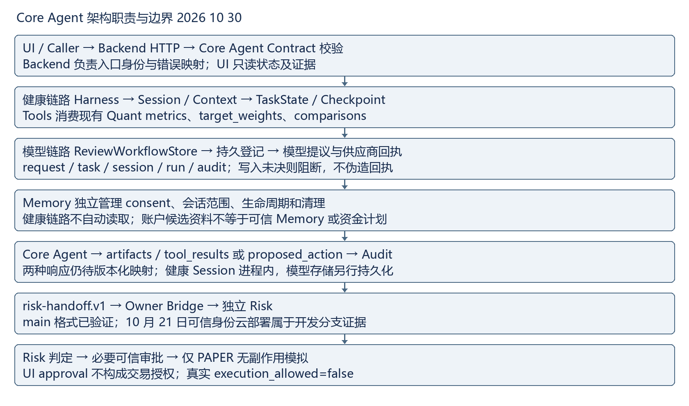
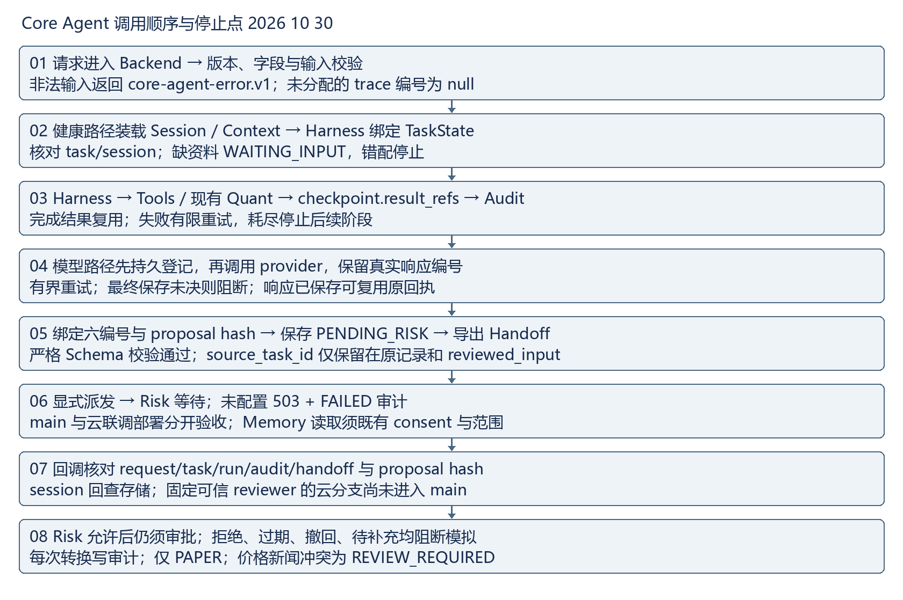

# Core Agent 主链路联调手册 2026 10 30

状态标注：已实现 = main 已有接口；已验证 = 本日离线检查通过；待 Owner 确认 = 正式可信 Risk 业务回写、跨链字段映射及持久化，均未验收。

已实现与已验证范围以两份 main 为准；可信身份云适配仅为开发分支留存证据。正式 Risk 业务闭环待 Owner 确认，execution_allowed=false。

## 架构职责与数据流

- Core Agent：组织结果、版本与 Handoff；不重算 Quant，不产生授权。
- Backend：HTTP、Contract、身份、错误映射与审计读取；消费原始 ID，不改证据。
- Harness：健康四阶段调度、有限重试、结果复用；唯一维护 TaskState/Checkpoint。
- Session 与 Context：健康 session 绑定、actor/environment/data_mode；模型 session 只是关联字段，不证明共用 Session 存储。
- TaskState：stage/status/checkpoint/completed/result_refs/resume_token；会话错配、缺输入、失败停止。
- Tools 与 Quant：validatePortfolio、diagnosePortfolio、generateCandidates、runSimulation；工具拥有版本/日期/输出。
- Memory：独立接口，显式 consent 与会话范围；健康链路不自动读取，调用方材料不是可信记忆。
- Risk：消费证据、校验 hash/身份、独立决策；正式接收/回写待 Owner 确认。
- UI：只消费状态、产物和恢复信息；不改审批身份、风险决策或 execution_allowed。
- Audit：健康 audit_evidence 与模型 audit.events 两种表示；不是 Memory，持久化能力按链路区分。

## 模块调用顺序与停止点

01 请求进入 Backend → 版本、字段与输入校验；非法输入返回 core-agent-error.v1；未分配的 trace 编号为 null

02 健康路径装载 Session / Context → Harness 绑定 TaskState；核对 task/session；缺资料 WAITING_INPUT，错配停止

03 Harness → Tools / 现有 Quant → checkpoint.result_refs → Audit；完成结果复用；失败有限重试，耗尽停止后续阶段

04 模型路径先持久登记，再调用 provider，保留真实响应编号；有界重试；最终保存未决则阻断；响应已保存可复用原回执

05 绑定六编号与 proposal hash → 保存 PENDING_RISK → 导出 Handoff；严格 Schema 校验通过；source_task_id 仅保留在原记录和 reviewed_input

06 显式派发 → Risk 等待；未配置 503 + FAILED 审计；main 与云联调部署分开验收；Memory 读取须既有 consent 与范围

07 回调核对 request/task/run/audit/handoff 与 proposal hash；session 回查存储；固定可信 reviewer 的云分支尚未进入 main

08 Risk 允许后仍须审批；拒绝、过期、撤回、待补充均阻断模拟；每次转换写审计；仅 PAPER；价格新闻冲突为 REVIEW_REQUIRED

## 统一 Contract 输入输出与必填字段

下列 required 从本轮 main Schema 读取；nullable 不等于可省略。版本和追踪关系还须语义验证。

### HealthCheckRequest

版本 investment-agent.v1；生产消费 Caller/Backend → Harness；源 contracts/investment-agent.v1.schema.json。

必填：contract_version, request_id, operation, context, input。

### HealthCheckResponse

版本 investment-agent.v1；生产消费 Harness/Core → Backend/Risk/UI；源 contracts/investment-agent.v1.schema.json。

必填：contract_version, request_id, operation, trace, task_state, artifacts, tool_results, audit_evidence, risk_handoff。

### ReviewRequest

版本 model-review.v1；生产消费 Caller → Backend；源 contracts/model-review.v1.schema.json。

必填：kind, text。

### WorkflowRecord

版本 review-workflow.v1；生产消费 ReviewWorkflowStore → Risk/UI；源 contracts/model-review.v1.schema.json。

必填：workflow_version, task_id, request_id, run_id, status, model, proposed_action, risk_handoff, risk_decision, approval, execution, audit。

### HandoffPackage

版本 risk-handoff.v1；生产消费 Core → Risk；源 contracts/risk-handoff.v1.schema.json。

必填：handoff_version, contract_version, workflow_version, schema_version, handoff_id, task_id, request_id, session_id, run_id, audit_id, data_mode, execution_mode, capability, plan_id, plan_hash, policy_version, owner, record_endpoint, workflow_status, status, decision, execution_allowed, proposal, reviewed_input, input_authority, model, evidence, approval, audit, memory_write_status, trace, callback。

### CallbackRequest

版本 risk-callback.v1；生产消费 Risk → Backend；源 contracts/risk-handoff.v1.schema.json。

必填：handoff_id, task_id, request_id, run_id, audit_id, reviewer, reason, callback_version, proposal_sha256, decision。

### SharedErrorEnvelope

版本 core-agent-error.v1；生产消费 Backend/Core → Caller/UI；源 contracts/core-agent-error.v1.schema.json。

必填：error_contract_version, source_contract_version, operation, request_id, trace, error。

## 字段归属与禁止修改

- contract_version/schema_version/workflow_version：对应 Contract 维护者冻结，Backend 校验并传递，Risk/UI 不临时改写版本。共享错误另有 error_contract_version/source_contract_version。
- request_id：Caller 或 Backend 入口确定；Core Agent 绑定当前请求，Risk/UI 引用不得改写。同任务重复请求可有新 request_id，历史审计 payload 保留原请求，不能覆盖历史证据。
- task_id/session_id：对应 Harness/ReviewWorkflowStore 创建或绑定；Backend/Risk/UI 消费不可替换关联。健康 session 是状态绑定；模型 session_id 可选且可 null，不能用 run_id 冒充 session。
- task_state/checkpoint：健康 Harness 唯一推进，Backend/UI/Risk 只读；completed/result_refs 必须引用存在的工具结果。模型 WorkflowRecord 使用 status，不具同名 task_state；映射待 Backend。
- artifacts/tool_results：现有工具/Quant 生产数值、版本、日期，Core Agent 组织引用；其他消费者不重新计算、不改原值。模型 proposed_action/model 并非已标准化的同名字段。
- risk_handoff：Core Agent 根据当前产物与审计装配，Risk 消费并通过独立回调产生决策；UI 不批准、不改 hash。健康 Handoff 与模型 HandoffPackage 不可直接混用。
- audit_evidence：健康 Harness/Core Agent 生产，模型用 audit.events。run_id/audit_id/handoff_id 按所属任务链生成，消费者原样引用，事件不可改写；模型存储持久化不证明健康 Session/Checkpoint 已跨重启持久化。
- error envelope：Backend/Core Agent 生产，Caller/UI 消费，code/message/retryable/stage/recovery 必填；trace 必填版本及 request/task/session/run/audit/handoff，未分配时可 null。不能凭 UI 文案将失败改为成功。
- source_task_id：当前仅在原模型记录与 reviewed_input 保留，不是 HandoffPackage 顶层字段；顶层别名已由此前业务提交移除，冻结 Schema 不变且复验通过。

## 状态与追踪限制

健康 WAITING_INPUT/BLOCKED/FAILED/CIRCUIT_OPEN 阻止后续阶段，HANDOFF_REQUIRED 为交接停止点。模型 status 枚举：PENDING_RISK, PENDING_APPROVAL, READY_FOR_SIMULATION, SIMULATED, REJECTED, EXPIRED, MODEL_FAILED, FUNDING_BLOCKED, CANCELLED。risk_dispatch.status 是另一字段，不替代任务 status；存储结果未决需等待核查，不自动换键重试。

WorkflowRecord.session_id 可选；HandoffPackage.session_id 必填可 null。回调只要求 request/task/run/audit/handoff 五编号，session 由存储关联。健康四个响应字段在模型记录中仍无版本化同名映射。健康 Session/Checkpoint 为进程内；模型存储登记与回执恢复不等于健康跨进程恢复。失效 checkpoint 引用可能结构合法但语义非法，需两类校验。audit_evidence 与 audit.events 不能仅凭名字当作同一个对象。

## 本轮验证与待 Owner 确认

两份 main 独立运行 check、284 项回归及 32 项严格 Schema/语义追踪检查；生成本日健康成功、同进程 Checkpoint 复用、失败信封证据。更新架构、模块时序和统一 Contract 联调手册，生成日报及手册 Word，嵌入可读图像。

本日复核结论：团队基线 b47fd74、个人基线 48f51bd 均无今日业务提交。新生成的健康成功、同任务同会话 Checkpoint 复用及失败信封通过严格校验；失效 result_refs 虽结构合法，语义校验仍拒绝。今日合成健康请求统一使用 req-daily-20261028 前缀，留存模型证据仍明确标注为 10 月 17 日回放。团队开发提交 9e6bed1 仍非任一 main 的祖先；10 月 21 日公网结果仅为历史分支证据。两份 main 本日实测均为 284/284。完整证据见本日 verification.json 与 trace.json。

- 两份 main 在 chenchen 运行 npm run check，exit 0；npm test -- --test-reporter=tap，各 284/284，失败和跳过均为 0；证据 daily-closeout-2026-10-30-check.txt、tests.txt。
- 两仓库在 chenchen 运行 python docs/daily-closeout-check-2026-10-30.py，各 32/32；7 个正向对象通过完整 Draft 2020-12 Schema；新健康成功、同进程复用及失败信封的 request/task/session/version/audit、四阶段 result_refs 通过语义追踪。10 月 17 日留存合成模型记录的 9 条事件、六编号与提议 hash 对齐；不是今日真实模型请求。证据本日 trace.json、synthetic.json、trace.txt。
- 复现需 Node >=22、Python jsonschema 4.26.0。本机用 bundled Python/Node，PYTHONPATH 指向自动化 python-deps，CORE_AGENT_NODE 指向 bundled node.exe；完整路径与基线见 verification.json。项目依赖未改。
- git merge-base --is-ancestor 9e6bed1 HEAD 在两仓库均 exit 1，说明该开发分支提交尚未合入 main；并记录关键实现文件的存在性。本日未重新调用公网、模型、Risk 派发或交易接口，费用调用为 0。
- 提交前执行 git diff --check 与 git diff --cached --check；本日 main 提交列表和远程编号核验见 verification.json 与 git-check.txt。

## 金融数据测试与职责边界

全量回归含 tests/market-brief.test.js：固定 2026-10-08/09 市场数据、价格新闻冲突及 Quant no-drift 通过，未检验今日实时行情。Core 消费现有 diagnosePortfolio.metrics、generateCandidates.target_weights、runSimulation.comparisons，未修改或重新计算 Quant。Memory consent、范围、生命周期及清理规则未改。

健康任务经过 RISK_CHECK/HANDOFF_REQUIRED 边界并停止；导出通过不代表独立 Risk 已审核。模型 session_id 可选，Handoff session_id 必填可 null；健康 Session/Checkpoint 为进程内，不能声称跨重启恢复。audit_evidence 与模型 audit.events 无统一版本化映射。前端 approval 不是交易授权，execution_allowed=false。价格新闻冲突只保留 REVIEW_REQUIRED，不自动产生交易动作。

## C 需要其他 Owner 配合的阻塞项

- Backend 与 Risk：可信回调和云适配实现停留在开发分支，main 缺完整对应实现；请给出审核合入的提交与同一真实业务任务接收、签名回写、幂等/冲突/过期回执，并冻结 provider_response_id 缺失协议。预期产出为可复现联合验收记录，不能把历史机器鉴权或缺失任务测试称作成功业务回调。
- Backend：健康 task_state/artifacts/tool_results/audit_evidence 与模型记录无版本化映射，健康状态仅进程内；请提供字段映射版本、持久化和跨实例幂等 Contract，避免 UI 拼接两种响应。
- Risk 与 Backend：可信人工审批及 Safety Action Gateway 未联合验收；请提供受保护审批身份和执行前再检查协议，真实执行保持关闭。
- UI 与 Backend：云入口尚非现有用户页面的正式后端，模型入口留存状态为 423；请确认服务端代理、本人隔离与 PENDING_RISK/FAILED/EXPIRED/REVIEW_REQUIRED、401/403/409/423 恢复样例及正式交付提交。
- Memory：缺既有授权下可信 memory_id、来源版本与撤回样例；请提供引用和 consent 证据，不扩展既有规则。
- Quant 与 Data：缺共同冻结的结果版本、真实快照来源、时效与冲突样例；请提供可审计数据及版本/日期，不能用固定夹具证明今日行情。

## 下一步

先由 Backend/Risk 审核开发分支并明确实际交付基线，冻结跨链字段映射；模型费用 Owner 确认提供方和预算后再安排受限真实模型到 Risk 的联合验收。UI 补代理与恢复回执，Memory/Quant/Data 提供可信样例。继续保持 PAPER 与真实执行阻断。

## Word 版式验收

日报与手册均含两幅可读图像，完成 ZIP、正文、图片数量和页面可用宽度结构检查。已尝试 render_docx.py；当前 bundled 运行环境未提供 soffice.exe，若日志报依赖缺失同样视为渲染失败；未生成逐页 PNG，逐页版式验收未完成，不能标称版式通过。详情见本日 render.txt。

### 本日严格追踪检查

两仓库本日严格 Draft 2020-12 Schema 与语义追踪检查均为 32/32（7 个正向对象）；生成 10 月 30 日健康成功/同进程复用/失败信封。10 月 17 日模型 9 条审计事件是留存合成回放，不是今日模型调用。失效 checkpoint result_refs 被语义校验拒绝。复现：在 chenchen 用 Python jsonschema 4.26.0 运行 docs/daily-closeout-check-2026-10-30.py；本机使用 bundled Python，PYTHONPATH 指向自动化 python-deps（系统 Python 首次缺 rpds 二进制，换 bundled 后通过）。
