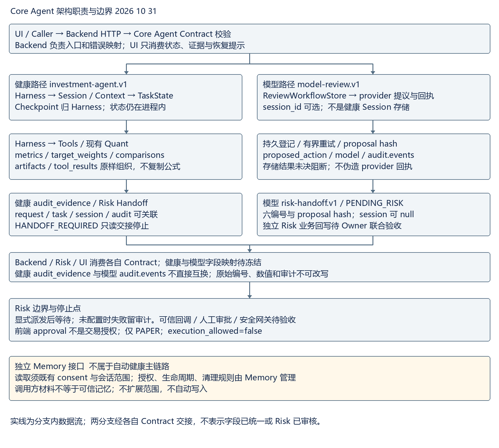
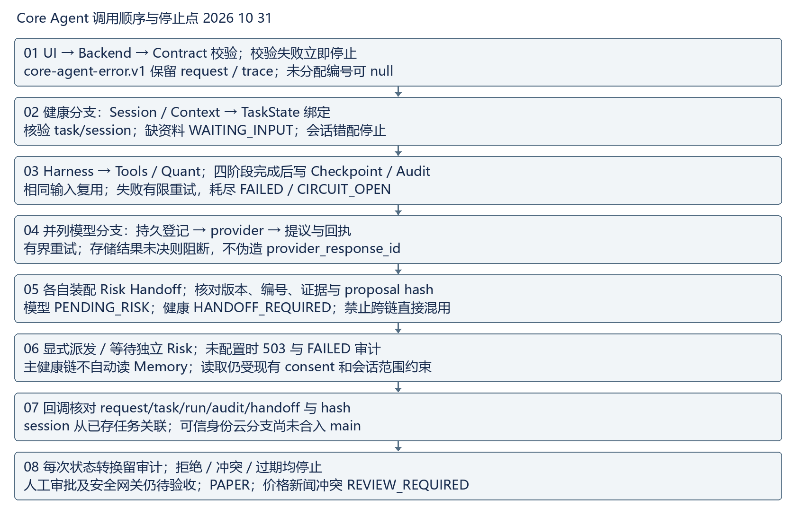

# Core Agent 主链路联调手册 2026 10 31

已实现以本日 main 基线为准；已验证为本日离线检查；待 Owner 确认为正式可信 Risk 业务回写、跨链映射和持久化。手册汇总现有 Contract，不宣称新增统一运行时 Schema。

## 架构职责与数据流

- Core Agent：组织结果、版本与 Handoff；不重算 Quant，不产生授权。
- Backend：HTTP、Contract、身份、错误映射与审计读取；消费原始 ID，不改证据。
- Harness：健康四阶段调度、有限重试、结果复用；唯一维护 TaskState/Checkpoint。
- Session 与 Context：健康 session 绑定、actor/environment/data_mode；模型 session 只是关联字段，不证明共用 Session 存储。
- TaskState：stage/status/checkpoint/completed/result_refs/resume_token；会话错配、缺输入、失败停止。
- Tools 与 Quant：validatePortfolio、diagnosePortfolio、generateCandidates、runSimulation；工具拥有版本/日期/输出。
- Memory：独立接口，显式 consent 与会话范围；健康链路不自动读取，调用方材料不是可信记忆。
- Risk：消费证据、校验 hash/身份、独立决策；正式接收/回写待 Owner 确认。
- UI：只消费状态、产物和恢复信息；不改审批身份、风险决策或 execution_allowed。
- Audit：健康 audit_evidence 与模型 audit.events 两种表示；不是 Memory，持久化能力按链路区分。

## 模块调用顺序与停止点

01 UI → Backend → Contract 校验；校验失败立即停止；core-agent-error.v1 保留 request / trace；未分配编号可 null

02 健康分支：Session / Context → TaskState 绑定；核验 task/session；缺资料 WAITING_INPUT；会话错配停止

03 Harness → Tools / Quant；四阶段完成后写 Checkpoint / Audit；相同输入复用；失败有限重试，耗尽 FAILED / CIRCUIT_OPEN

04 并列模型分支：持久登记 → provider → 提议与回执；有界重试；存储结果未决则阻断，不伪造 provider_response_id

05 各自装配 Risk Handoff；核对版本、编号、证据与 proposal hash；模型 PENDING_RISK；健康 HANDOFF_REQUIRED；禁止跨链直接混用

06 显式派发 / 等待独立 Risk；未配置时 503 与 FAILED 审计；主健康链不自动读 Memory；读取仍受现有 consent 和会话范围约束

07 回调核对 request/task/run/audit/handoff 与 hash；session 从已存任务关联；可信身份云分支尚未合入 main

08 每次状态转换留审计；拒绝 / 冲突 / 过期均停止；人工审批及安全网关仍待验收；PAPER；价格新闻冲突 REVIEW_REQUIRED

## 统一 Contract 输入输出与必填字段

以下 required/可选字段由本日 main Schema 直接读取。必填可 null 不等于可省略；嵌套约束以所列运行时 Schema 为准。

### HealthCheckRequest

版本 investment-agent.v1；生产消费 Caller/Backend → Harness；源 contracts/investment-agent.v1.schema.json。

必填：contract_version, request_id, operation, context, input。

可选：无。

### HealthCheckResponse

版本 investment-agent.v1；生产消费 Harness/Core → Backend/Risk/UI；源 contracts/investment-agent.v1.schema.json。

必填：contract_version, request_id, operation, trace, task_state, artifacts, tool_results, audit_evidence, risk_handoff。

可选：无。

### ReviewRequest

版本 model-review.v1；生产消费 Caller → Backend；源 contracts/model-review.v1.schema.json。

必填：kind, text。

可选：action_parameters, allow_rule_fallback, capability, context, data_mode, execution_mode, idempotency_key, memory_consent, output_formats, plan_hash, plan_id, policy_version, portfolio_snapshot_id, request_id, requested_action, risk_profile_version, scenario, schema_version, session_id, source, source_task_id, task_id。

### WorkflowRecord

版本 review-workflow.v1；生产消费 ReviewWorkflowStore → Risk/UI；源 contracts/model-review.v1.schema.json。

必填：workflow_version, task_id, request_id, run_id, status, model, proposed_action, risk_handoff, risk_decision, approval, execution, audit。

可选：capability, data_mode, error, execution_mode, idempotency_key, memory_consent, memory_write_status, output_contract, plan_hash, plan_id, policy_version, portfolio_snapshot_id, risk_dispatch, risk_profile_version, scenario, schema_version, session_id, source_task_id。

### HandoffPackage

版本 risk-handoff.v1；生产消费 Core → Risk；源 contracts/risk-handoff.v1.schema.json。

必填：handoff_version, contract_version, workflow_version, schema_version, handoff_id, task_id, request_id, session_id, run_id, audit_id, data_mode, execution_mode, capability, plan_id, plan_hash, policy_version, owner, record_endpoint, workflow_status, status, decision, execution_allowed, proposal, reviewed_input, input_authority, model, evidence, approval, audit, memory_write_status, trace, callback。

可选：cancellation, funding_check, output_contract, portfolio_snapshot_id, risk_dispatch, risk_profile_version, scenario。

### CallbackRequest

版本 risk-callback.v1；生产消费 Risk → Backend；源 contracts/risk-handoff.v1.schema.json。

必填：handoff_id, task_id, request_id, run_id, audit_id, reviewer, reason, callback_version, proposal_sha256, decision。

可选：无。

### SharedErrorEnvelope

版本 core-agent-error.v1；生产消费 Backend/Core → Caller/UI；源 contracts/core-agent-error.v1.schema.json。

必填：error_contract_version, source_contract_version, operation, request_id, trace, error。

可选：无。

## 字段归属与禁止修改

- contract_version/schema_version/workflow_version：对应 Contract 维护者冻结，Backend 校验并传递，Risk/UI 不临时改写版本。共享错误另有 error_contract_version/source_contract_version。
- request_id：Caller 或 Backend 入口确定；Core Agent 绑定当前请求，Risk/UI 引用不得改写。同任务重复请求可有新 request_id，历史审计 payload 保留原请求，不能覆盖历史证据。
- task_id/session_id：对应 Harness/ReviewWorkflowStore 创建或绑定；Backend/Risk/UI 消费不可替换关联。健康 session 是状态绑定；模型 session_id 可选且可 null，不能用 run_id 冒充 session。
- task_state/checkpoint：健康 Harness 唯一推进，Backend/UI/Risk 只读；completed/result_refs 必须引用存在的工具结果。模型 WorkflowRecord 使用 status，不具同名 task_state；映射待 Backend。
- artifacts/tool_results：现有工具/Quant 生产数值、版本、日期，Core Agent 组织引用；其他消费者不重新计算、不改原值。模型 proposed_action/model 并非已标准化的同名字段。
- risk_handoff：Core Agent 根据当前产物与审计装配，Risk 消费并通过独立回调产生决策；UI 不批准、不改 hash。健康 Handoff 与模型 HandoffPackage 不可直接混用。
- audit_evidence：健康 Harness/Core Agent 生产，模型用 audit.events。run_id/audit_id/handoff_id 按所属任务链生成，消费者原样引用，事件不可改写；模型存储持久化不证明健康 Session/Checkpoint 已跨重启持久化。
- error envelope：Backend/Core Agent 生产，Caller/UI 消费，code/message/retryable/stage/recovery 必填；trace 必填版本及 request/task/session/run/audit/handoff，未分配时可 null。不能凭 UI 文案将失败改为成功。
- source_task_id：当前仅在原模型记录与 reviewed_input 保留，不是 HandoffPackage 顶层字段；顶层别名已由此前业务提交移除，冻结 Schema 不变且复验通过。

## 状态与追踪限制

健康 WAITING_INPUT/BLOCKED/FAILED/CIRCUIT_OPEN 停止后续阶段，HANDOFF_REQUIRED 为交接停止点。模型 PENDING_RISK、PENDING_APPROVAL、READY_FOR_SIMULATION、SIMULATED、REJECTED、EXPIRED、MODEL_FAILED、FUNDING_BLOCKED、CANCELLED 不等价于健康 task_state。risk_dispatch.status 不能替代任务 status。存储结果未决先核查，不自动换键重试。

WorkflowRecord.session_id 可选；HandoffPackage.session_id 必填可 null。CallbackRequest 要求 request/task/run/audit/handoff 五编号和 hash，session 回查存储，不要求第六个回调编号。健康 audit_evidence 与模型 audit.events 无冻结映射；健康同进程 Checkpoint 复用不证明跨实例或跨重启恢复。

## 本日检查结论及 Owner 阻塞

- 在两份干净 main 快照的 chenchen 目录分别运行 npm run check：exit 0；npm test -- --test-reporter=tap：各 284/284，失败和跳过均为 0。证据 daily-closeout-2026-10-31-check.txt、daily-closeout-2026-10-31-tests.txt。
- 在 chenchen 运行 python docs/daily-closeout-check-2026-10-31.py：各 32/32，7 个正向对象完整 Draft 2020-12 Schema 通过。新生成健康成功/复用/失败，request_id、task_id、session_id、Contract version、audit_evidence 与四阶段 result_refs 可追踪。失败信封也保留已分配的 task/session/audit。
- 同一检查复验 10 月 17 日留存的合成模型记录：9 条 audit.events、六编号和提议 hash 对齐。这是历史回放，不是今日真实模型调用或 Risk 接收。本日不发起公网、模型、付费、Risk 派发或交易调用。
- 复现依赖 Node >=22、Python jsonschema 4.26.0；本机 bundled Python/Node 和自动化 python-deps 的完整路径见本日 verification.json。未改变项目依赖。执行 git diff --check 和 git diff --cached --check，原始结果见本日 git-check.txt。

## 金融数据测试与边界

tests/market-brief.test.js 的 4 项固定夹具回归已在本日全量测试通过：2026-10-08/09 市场上下文、价格新闻冲突和 Quant no-drift。未验证今日实时行情。Core 消费现有 diagnosePortfolio.metrics、generateCandidates.target_weights、runSimulation.comparisons；没有改写 Quant 算法或另建计算逻辑，离线测试仅调用既有工具。

Memory 的 consent、范围、生命周期和清理规则未改；健康链路不自动读 Memory。健康任务经过 RISK_CHECK/HANDOFF_REQUIRED 并停止，模型留存记录仍为 PENDING_RISK。前端 approval 不是交易授权；execution_allowed=false。价格和新闻方向冲突只记录 REVIEW_REQUIRED，不自动产生交易动作。

追踪限制：健康 Session/Checkpoint 仍为进程内，本日只验证同进程复用；WorkflowRecord.session_id 可选，HandoffPackage.session_id 必填但可 null；模型 audit.events 与健康 audit_evidence 无版本化映射。结构校验不能替代语义校验或 Owner 审核。

## C 需要其他 Owner 配合的阻塞项

- Risk 与 Backend：main 尚无正式可信业务接收/回写联合验收。需要 Owner 给出审核合入基线、同任务签名回调、身份、幂等、冲突、过期与存储未决回执；预期产出为可复现联合验收记录。留存云分支 9e6bed1 未合入任一 main，不能用旧鉴权测试代替业务闭环。
- Backend：健康 task_state/artifacts/tool_results/audit_evidence 与模型记录无版本化映射，健康状态仅进程内。需要字段映射版本、持久化与跨实例幂等 Contract，并确认 provider_response_id 缺失时的拒绝与恢复协议。
- Risk 与 Backend：可信人工审批和 Safety Action Gateway 未验收。需要受保护审批身份及执行前再检查协议，真实执行继续关闭。
- UI 与 Backend：需要确认正式服务端代理、本人隔离、PENDING_RISK/FAILED/EXPIRED/REVIEW_REQUIRED 和 401/403/409/423 恢复行为。预期产出为指定 main 基线的集成回执；本日没有新浏览器验收。
- Memory：缺既有 consent 下可信 memory_id、来源版本和撤回样例。需要引用及授权证据，不扩展原有规则。
- Quant 与 Data：缺共同冻结的结果版本、真实数据来源、时效和冲突样例。需要带版本及数据日期的可审计样例；固定夹具不能证明今日行情。

## 下一步

先由 Backend/Risk 确定审核合入基线和同任务回写验收，再冻结健康/模型字段映射与恢复协议。UI 补正式代理及恢复样例，Memory/Quant/Data 提供可信引用和版本化样例。模型提供方与预算获确认后，再安排受限真实模型至 Risk 联调。

## Word 版式验收

日报和手册均嵌入架构与时序图，已做 ZIP、OOXML、正文、图片数量和宽度结构检查。已尝试标准 render_docx.py；当前运行环境缺少 LibreOffice soffice.exe，未生成逐页 PNG，逐页版式验收未完成。不得将结构通过表述为版式通过，详见本日 render.txt。

